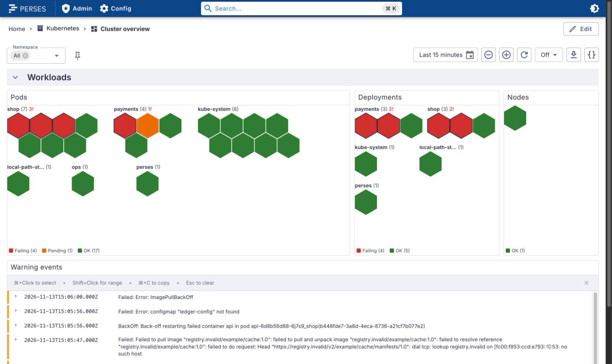
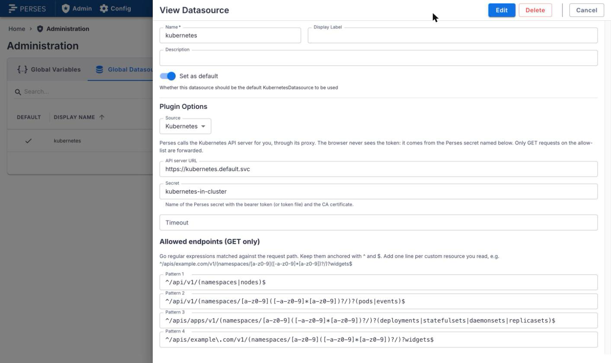
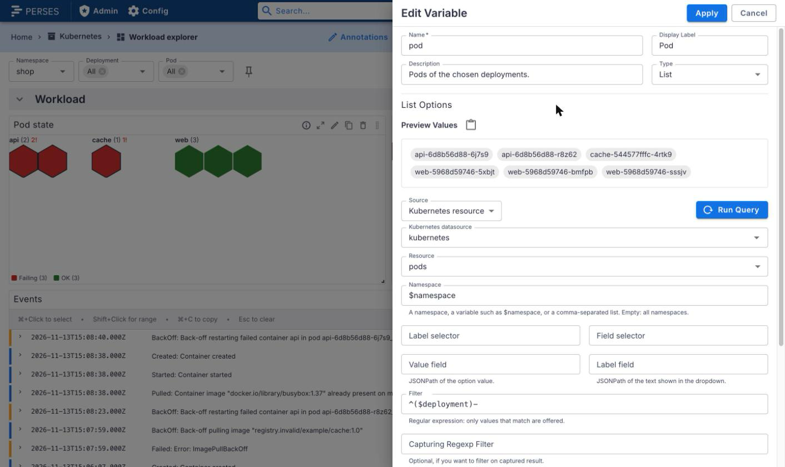
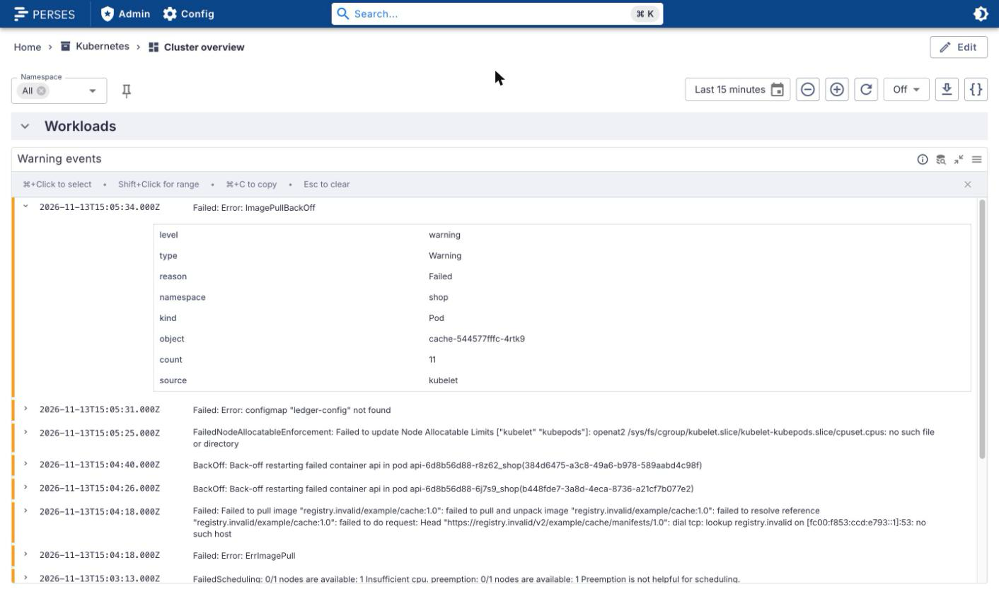
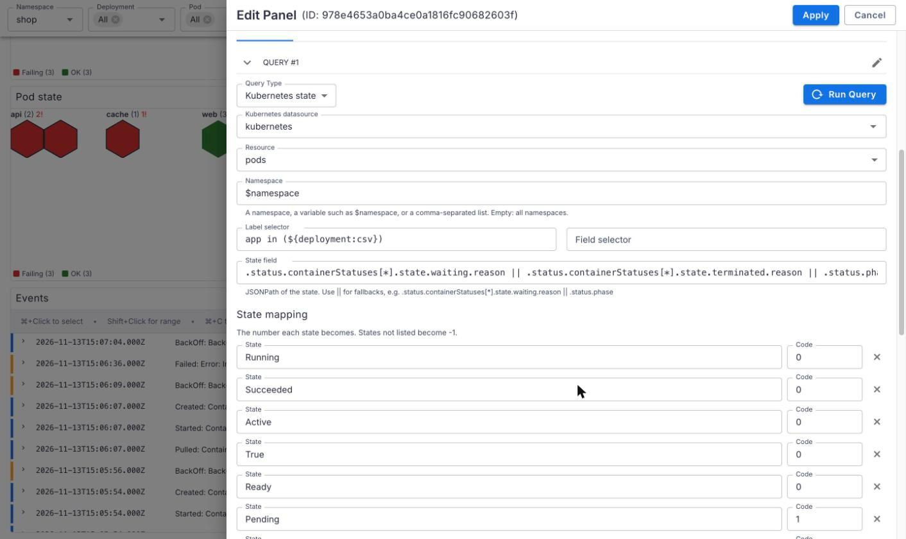
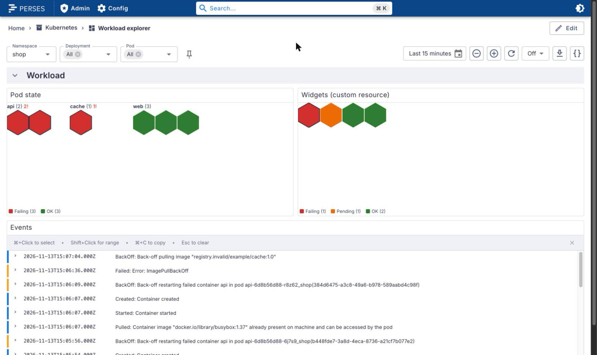

# perses-plugin-kubernetes

A [Perses](https://perses.dev) plugin module that reads the Kubernetes API **live and read-only**, through the Perses
backend proxy. It has four plugins:

| Kind                         | Type              | What it gives you                                                                |
| ---------------------------- | ----------------- | -------------------------------------------------------------------------------- |
| `KubernetesDatasource`       | Datasource        | The API server behind the Perses proxy: GET only, on an allow-list of list paths |
| `KubernetesResourceVariable` | Variable          | Namespaces, pods, deployments, nodes or custom resources as variable values      |
| `KubernetesEventsQuery`      | Log query         | Kubernetes events as log lines, for the upstream LogsTable panel                 |
| `KubernetesStateQuery`       | Time series query | Each object's current state as a number, for the honeycomb and other panels      |

The browser never sees a cluster token: Perses adds it from a secret and forwards only `GET` requests that match the
datasource's allow-list.

<picture>
  <source media="(prefers-color-scheme: dark)" srcset="docs/images/cluster-overview-dark.png">
  
</picture>

The pods, deployments and nodes above are `KubernetesStateQuery` series drawn by
[perses-plugin-honeycomb](https://github.com/astrona-io/perses-plugin-honeycomb); the warning events are a
`KubernetesEventsQuery` in the upstream LogsTable. No Prometheus is involved.

## Supported versions

| Plugin | Perses  | Status              |
| ------ | ------- | ------------------- |
| 0.1.x  | v0.55.x | Tested with v0.55.1 |

The plugin is built against `@perses-dev/*` 0.55.1 and `percli` v0.55.1. Other Perses minor versions may work but are
not tested. On the Kubernetes side it uses only the `core/v1` and `apps/v1` list endpoints (plus the custom resources
you add), so any supported Kubernetes release works; it was tested on a kind v0.33 cluster.

## What it can and can't do, compared with kube-state-metrics

kube-state-metrics turns object state into Prometheus series, so you get history, alerting and PromQL. This plugin asks
the API server what is true **now**.

| You want                                                              | kube-state-metrics | this plugin |
| --------------------------------------------------------------------- | ------------------ | ----------- |
| Variables that list what exists now (no deleted pods, no scrape lag)  | approximate        | yes         |
| Event messages, condition reasons, image tags, any field by JSONPath  | no                 | yes         |
| Custom resources (Flux Kustomizations, Trivy reports, your own CRDs)  | only if configured | yes         |
| History: what the state was an hour ago, durations, trends            | yes                | no          |
| Alerting                                                              | yes                | no          |
| Aggregation across many clusters                                      | yes                | no          |
| No extra load on the API server per dashboard view                    | yes                | no          |

Use both: Prometheus for history and alerts, this plugin for "what is broken right now, and why".

Each panel refresh is one list request per resource (one per namespace when a multi-value namespace variable is not
"All"), paged with `limit`/`continue` (500 per page, at most 5000 objects per query, after which the result is marked
truncated). Selectors are applied by the API server. There is no `watch`: data refreshes when the dashboard does.

## Security model

This is the most important part of the plugin. Several layers each block what the others might miss:

1. **Proxy only.** The datasource has no `directUrl`. The CUE schema rejects one, and an empty allow-list too.
2. **GET only, on an anchored allow-list.** The Perses proxy forwards a request only when its method equals an entry's
   `method` and the entry's `endpointPattern` (a Go regular expression) matches the path. The default list allows
   only the list endpoints of the builtin resources:

   ```yaml
   allowedEndpoints:
     - endpointPattern: ^/api/v1/(namespaces|nodes)$
       method: GET
     - endpointPattern: ^/api/v1/(namespaces/[a-z0-9]([-a-z0-9]*[a-z0-9])?/)?(pods|events)$
       method: GET
     - endpointPattern: ^/apis/apps/v1/(namespaces/[a-z0-9]([-a-z0-9]*[a-z0-9])?/)?(deployments|statefulsets|daemonsets|replicasets)$
       method: GET
   ```

   Every pattern is anchored with `^` and `$`. The proxy matches a pattern _anywhere_ in the path, so an unanchored
   `/api/v1/pods` would also let `/api/v1/namespaces/x/pods/y/exec` through. The schema rejects unanchored patterns,
   other methods, and patterns that mention secrets, exec, attach, portforward, proxy, log or watch.

3. **No single objects, no subresources.** The plugin only builds list paths. A namespace from a variable is checked
   as a DNS label, so a value like `x/pods/y/exec` can't add path segments. `secrets`, `serviceaccounts` and token
   reviews are refused even as a custom resource.
4. **RBAC.** The service account gets `get` and `list` on the resources it reads, and nothing else. The proxy matches
   paths, not query strings, so `?watch=true` passes the allow-list; RBAC refuses it, because `watch` is never granted.

`dev/proxy-check.sh` tests this against a running Perses: 7 allowed list requests must return 200, and 20 others must
return 403 (other methods, secrets, configmaps, single objects, exec, log, attach, portforward, service and node proxy,
the `/watch/` path, RBAC objects, `/apis`, `/version`, and `?watch=true`). The allow-list is also unit tested in
TypeScript and, with Go's own `regexp` engine (the one the proxy uses), in `test/allowlist`.

## Setup

### RBAC

[`deploy/rbac.yaml`](deploy/rbac.yaml) holds two variants. Pick one, and change the service account and namespace
(`perses`/`perses`) to where Perses runs:

- **A. Cluster-wide**: a `ClusterRole` with `get` and `list` on namespaces, nodes, pods, events, deployments,
  statefulsets, daemonsets and replicasets, and a `ClusterRoleBinding`.
- **B. Namespaced**: a `Role` and `RoleBinding` per namespace Perses may show. Namespaces and nodes are cluster-scoped,
  so a namespaced Role can't list them: use a fixed list or a custom variable for the namespace.

Never grant `watch`, `secrets`, `configmaps` or any subresource (`pods/log`, `pods/exec`, ...).

### In cluster (Perses runs in the cluster it shows)

Perses uses its own pod's service account. The token and CA are files in the pod, so the secret points at them, and
Perses reads them on every request (the projected token rotates). Add to the Perses config:

```yaml
security:
  # Lets a secret read the pod's service account token and CA. No other directory is readable.
  secret_file_allowed_directories:
    - /var/run/secrets/kubernetes.io/serviceaccount
datasource:
  proxy:
    # The proxy refuses private addresses by default. Allow the API server's service IP only:
    #   kubectl get svc kubernetes -n default -o jsonpath='{.spec.clusterIP}'
    allowed_networks:
      - 10.96.0.1/32
```

Then a secret and a datasource (global ones here; a project `Secret` and `Datasource` work the same way):

```yaml
kind: GlobalSecret
metadata:
  name: kubernetes-in-cluster
spec:
  authorization:
    type: Bearer
    credentialsFile: /var/run/secrets/kubernetes.io/serviceaccount/token
  tlsConfig:
    caFile: /var/run/secrets/kubernetes.io/serviceaccount/ca.crt
---
kind: GlobalDatasource
metadata:
  name: kubernetes
spec:
  default: true
  plugin:
    kind: KubernetesDatasource
    spec:
      proxy:
        kind: HTTPProxy
        spec:
          url: https://kubernetes.default.svc
          secret: kubernetes-in-cluster
          allowedEndpoints:
            - endpointPattern: ^/api/v1/(namespaces|nodes)$
              method: GET
            - endpointPattern: ^/api/v1/(namespaces/[a-z0-9]([-a-z0-9]*[a-z0-9])?/)?(pods|events)$
              method: GET
            - endpointPattern: ^/apis/apps/v1/(namespaces/[a-z0-9]([-a-z0-9]*[a-z0-9])?/)?(deployments|statefulsets|daemonsets|replicasets)$
              method: GET
```

The datasource editor fills in the default allow-list for a new datasource.

### Out of cluster (Perses runs elsewhere)

Create a service account in the target cluster, bind it with `deploy/rbac.yaml`, and give it a token (a bound token
from `kubectl create token`, or a `kubernetes.io/service-account-token` Secret). Put the token and the cluster CA in a
Perses secret, as files mounted into Perses (their directory then goes in `secret_file_allowed_directories`) or inline:

```yaml
kind: GlobalSecret
metadata:
  name: kubernetes-remote
spec:
  authorization:
    type: Bearer
    credentialsFile: /etc/perses/kubernetes/token
  tlsConfig:
    caFile: /etc/perses/kubernetes/ca.crt
```

Set the datasource `url` to the API server (for example `https://api.example.com:6443`). If it resolves to a private
address, add that address to `datasource.proxy.allowed_networks`. Never set `insecureSkipVerify`.

### Custom resources

Add one allow-list entry and one RBAC rule per custom resource you read, then use `resource: custom` with
`customResource: <group>/<version>/<plural>`:

```yaml
# datasource allowedEndpoints
- endpointPattern: ^/apis/kustomize\.toolkit\.fluxcd\.io/v1/(namespaces/[a-z0-9]([-a-z0-9]*[a-z0-9])?/)?kustomizations$
  method: GET
# ClusterRole rules
- apiGroups: [kustomize.toolkit.fluxcd.io]
  resources: [kustomizations]
  verbs: [get, list]
```

Escape the dots in the group. Never use `resources: ["*"]`.

## The plugins

### KubernetesDatasource

| Option                        | Description                                                    |
| ----------------------------- | -------------------------------------------------------------- |
| `proxy.spec.url`              | API server URL, for example `https://kubernetes.default.svc`   |
| `proxy.spec.secret`           | Perses secret with the bearer token (or token file) and the CA |
| `proxy.spec.allowedEndpoints` | Anchored `GET` patterns; required and non-empty                |
| `proxy.spec.timeout`          | Optional request timeout                                       |

<picture>
  <source media="(prefers-color-scheme: dark)" srcset="docs/images/datasource-editor-dark.png">
  
</picture>

### KubernetesResourceVariable

| Option           | Description                                                                                              |
| ---------------- | -------------------------------------------------------------------------------------------------------- |
| `datasource`     | A `KubernetesDatasource`; the default one when unset                                                     |
| `resource`       | `namespaces`, `nodes`, `pods`, `deployments`, `statefulsets`, `daemonsets`, `replicasets` or `custom`    |
| `customResource` | `group/version/plural` when `resource` is `custom`, for example `kustomize.toolkit.fluxcd.io/v1/kustomizations` |
| `namespace`      | A namespace, `$variable` or a comma-separated list; empty means all namespaces                           |
| `labelSelector`  | Kubernetes label selector, applied by the API server; variables allowed                                  |
| `fieldSelector`  | Kubernetes field selector, applied by the API server; variables allowed                                  |
| `valueField`     | JSONPath of the value; default `.metadata.name`                                                          |
| `labelField`     | JSONPath of the text shown in the dropdown; default the value                                            |
| `filter`         | Regular expression the value must match; variables allowed                                               |

Variables chain: a pod variable with `namespace: $namespace` and `filter: ^($deployment)-` lists the pods of the chosen
deployments, and reloads when either parent changes.

<picture>
  <source media="(prefers-color-scheme: dark)" srcset="docs/images/variable-editor-dark.png">
  
</picture>

For a namespace variable with "All", set `customAllValue: "*"`. "All" then means one cluster-wide request; without it,
Perses passes every option and the plugin sends one request per namespace.

### KubernetesEventsQuery (log query)

| Option               | Description                                                        |
| -------------------- | ------------------------------------------------------------------ |
| `datasource`         | A `KubernetesDatasource`                                           |
| `namespace`          | A namespace, `$variable` or list; empty means all namespaces       |
| `involvedObjectKind` | Kind of the object, for example `Pod`; multi-value variables work  |
| `involvedObjectName` | Name of the object; multi-value variables work                     |
| `type`               | `Normal` or `Warning`                                              |
| `reason`             | Regular expression on the reason, for example `^(BackOff\|Failed)$` |
| `limit`              | Most recent events to keep; default 1000, at most 5000             |

Each event becomes a log line `<reason>: <message>` at its last time, with the labels `level` (`warning` or `info`),
`type`, `reason`, `namespace`, `kind`, `object`, `count` and `source`. Only events inside the dashboard time range are
kept. Kind, name and type go to the API server as a field selector. Kubernetes keeps events for an hour by default, so
older ranges are empty.

<picture>
  <source media="(prefers-color-scheme: dark)" srcset="docs/images/events-table-dark.png">
  
</picture>

### KubernetesStateQuery (time series query)

| Option                                                                                    | Description                                                                |
| ----------------------------------------------------------------------------------------- | -------------------------------------------------------------------------- |
| `datasource`, `resource`, `customResource`, `namespace`, `labelSelector`, `fieldSelector` | As for the variable                                                        |
| `stateField`                                                                              | JSONPath of the state; `\|\|` gives fallbacks. Default `.status.phase`     |
| `stateMapping`                                                                            | `[{value, code}]`: state to number. States not listed become `-1`          |
| `labelFields`                                                                             | `[{name, path}]`: extra series labels read by JSONPath                     |

Each object becomes one series with one point at the end of the time range. Its labels are `name`, `namespace`, `kind`,
`state` and your `labelFields`; its value is the mapped code. The default mapping gives 0 to fine states (`Running`,
`Succeeded`, `Ready`, `True`, `Active`), 1 to states in progress (`Pending`, `ContainerCreating`, `PodInitializing`,
`Terminating`) and 2 to broken ones (`Failed`, `False`, `Unknown`, `CrashLoopBackOff`, `ImagePullBackOff`,
`ErrImagePull`, `CreateContainerConfigError`, `OOMKilled`, `Error`).

<picture>
  <source media="(prefers-color-scheme: dark)" srcset="docs/images/state-query-editor-dark.png">
  
</picture>

Useful state fields:

```yaml
# Pods: the waiting or terminated reason, else the phase. A crash-looping pod between restarts stays red.
stateField: .status.containerStatuses[*].state.waiting.reason || .status.containerStatuses[*].state.terminated.reason || .status.phase
# Deployments, nodes, Flux objects: a condition
stateField: .status.conditions[?(@.type=="Available")].status
stateField: .status.conditions[?(@.type=="Ready")].status
```

The JSONPath subset is what kubectl users write: `.a.b`, `['quoted.key']`, `[0]`, `[*]`, `[?(@.f=="v")]` and `!=`.

## The workload explorer

The second demo dashboard chains namespace, deployment and pod variables. It shows the pods of the chosen deployments,
a custom resource with its own state mapping, and the events of the chosen pods.

<picture>
  <source media="(prefers-color-scheme: dark)" srcset="docs/images/workload-explorer-dark.png">
  
</picture>

## Try it locally

`dev/` runs a kind cluster with Perses inside it (as a pod, with its own service account), this plugin, the
[honeycomb panel](https://github.com/astrona-io/perses-plugin-honeycomb), the RBAC from `deploy/rbac.yaml`, and
deliberately broken workloads: a crash-looping deployment, an image that can't be pulled, a pod that can't be
scheduled, a missing ConfigMap, and a custom resource with ready, reconciling and failed objects. The screenshots above
come from it. It needs `kind`, `kubectl`, `percli`, Node.js, and podman or Docker.

```bash
KIND_EXPERIMENTAL_PROVIDER=podman ./dev/up.sh   # leave the variable out for Docker
./dev/proxy-check.sh                             # the security checks, against the running Perses
./dev/down.sh
```

Open <http://127.0.0.1:18083/projects/kubernetes/dashboards/cluster-overview>. The stack writes its own kubeconfig to
`dev/.kubeconfig` and never touches your current context.

## Build

```bash
npm ci
npm run build          # module-federation bundle in dist/
percli plugin build    # writes Kubernetes-<version>.tar.gz
```

See `CONTRIBUTING.md` for the checks and the release process.

## Install into Perses

Perses extracts every `*.tar.gz` in `plugin.archive_paths` into `plugin.path` at startup. Setting `archive_paths`
replaces the default, so keep the directory of bundled plugins in the list. Pick one of the three options below, add
the security config from [Setup](#setup), and restart Perses.

### Option A: release archive

Download `Kubernetes-<version>.tar.gz` from the
[GitHub releases](https://github.com/astrona-io/perses-plugin-kubernetes/releases), check it against its `.sha256`, put
it in a directory Perses can read, and add that directory to the config:

```bash
curl -fLO https://github.com/astrona-io/perses-plugin-kubernetes/releases/download/v0.1.0/Kubernetes-0.1.0.tar.gz
curl -fLO https://github.com/astrona-io/perses-plugin-kubernetes/releases/download/v0.1.0/Kubernetes-0.1.0.tar.gz.sha256
sha256sum -c Kubernetes-0.1.0.tar.gz.sha256
```

```yaml
plugin:
  archive_paths:
    - /etc/perses/plugins-archive # plugins bundled with Perses
    - /etc/perses/plugins-archive-kubernetes # put Kubernetes-0.1.0.tar.gz here
```

### Option B: Kubernetes image volume

The `Containerfile` packages the archive as a plugin-only OCI image (`FROM scratch`, the archive at the image root).
Every release publishes it as `ghcr.io/astrona-io/perses-plugin-kubernetes:v<version>` for linux/amd64 and
linux/arm64. Mount it into the Perses pod as an [image volume](https://kubernetes.io/docs/concepts/storage/volumes/#image)
and add the mount path to `archive_paths` as in option A. Image volumes need a cluster and container runtime that
support them (the `ImageVolume` feature).

```yaml
volumes:
  - name: kubernetes-plugin
    image:
      reference: ghcr.io/astrona-io/perses-plugin-kubernetes:v0.1.0
      pullPolicy: IfNotPresent
containers:
  - name: perses
    volumeMounts:
      - name: kubernetes-plugin
        mountPath: /etc/perses/plugins-archive-kubernetes
        readOnly: true
```

To build and push it to your own registry instead:

```bash
percli plugin build
podman build -t <registry>/perses-plugin-kubernetes:<version> .
podman push <registry>/perses-plugin-kubernetes:<version>
```

### Option C: custom Perses image

Copy the archive into the directory of bundled plugins. No `archive_paths` change is needed:

```dockerfile
FROM persesdev/perses:v0.55.1
COPY Kubernetes-0.1.0.tar.gz /etc/perses/plugins-archive/
```

## Documentation

- [`docs/PLAN.md`](docs/PLAN.md): data model, components and schemas.
- [`docs/DECISIONS.md`](docs/DECISIONS.md): decisions made while building it, and why.
- [`docs/upstream-proposal.md`](docs/upstream-proposal.md): a draft proposal (not filed) for tables of resources through `JsonQuery` and the Table panel.

## Licences and credits

The plugin is Apache-2.0 (`LICENSE`). Third-party material and its notices are listed in `NOTICE`.
